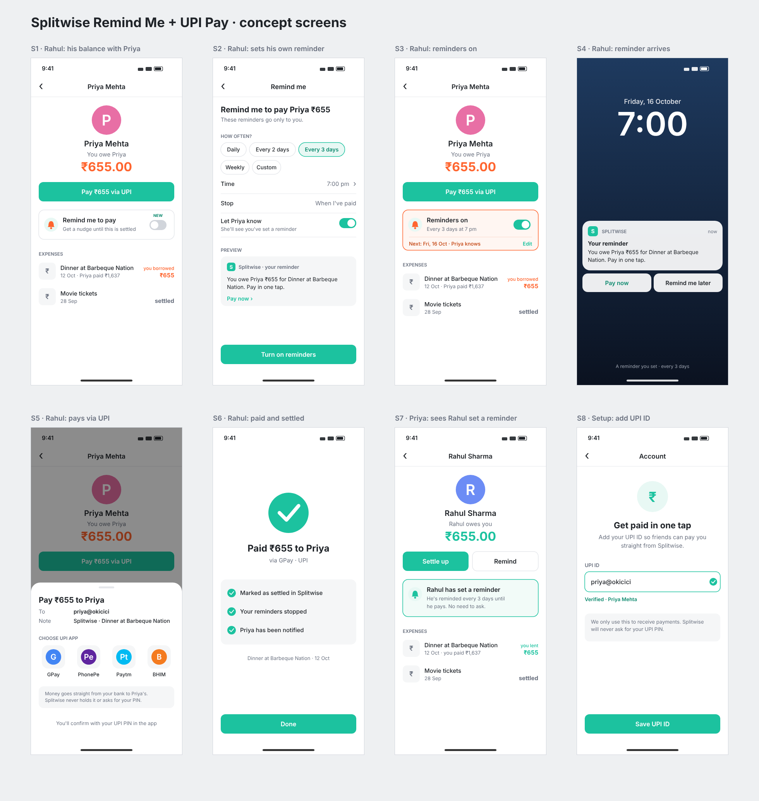

# Splitwise Product Case Study: Remind Me + UPI Pay

A product case study on why group debts in Splitwise stay unpaid, and a feature concept that fixes it without anyone having to ask a friend for money.

**Author:** Omprakash Balara · **Date:** October 2026 · **Type:** Independent concept case study (not built or launched)

---

## 1. Overview

- **Product:** Splitwise, the app that groups use to split shared bills.
- **Goal:** find out why money owed in Splitwise stays unpaid for a long time, and design a fix.
- **My role:** I did everything end to end: user interviews, competitive check, problem prioritization, the PRD and the Figma screens.
- **Skills used:** user research, competitive analysis, prioritization, PRD writing, success metrics, UI design in Figma.

## 2. Research

- I interviewed **10 Splitwise users** one-on-one, ranging from a 17-year-old college student to salaried and married professionals.
- I asked how they split group bills, how they track spending and how they settle up.
- I wrote up 3 interviews in detail. The other 7 gave very similar answers.
- Full notes: [research/interview-summary.md](research/interview-summary.md)

## 3. Pain points found

1. **Entering long bills by hand is tedious.** This came up in 3 of 3 detailed interviews.
2. **There's no monthly or category-wise view of spending.** This came up in 3 of 3.
3. **Asking a friend for money feels awkward, and being asked feels embarrassing.** This came up in 3 of 3.
4. **People forget to pay, because paying happens in a separate UPI app.** This came up in 2 of 3.

## 4. Competitive check and prioritization

| Pain point | Already solved? |
|---|---|
| 1. Entering long bills by hand | Yes. Splitwise Pro has receipt scanning and itemization. |
| 2. No spending view | Yes. Splitwise Pro has charts and graphs. |
| 3. Awkward to ask for money | **No.** There's only a manual Remind button that the lender has to press. |
| 4. Forgetting to pay | **No.** Splitwise has no UPI payment built in. |

- Splitwise Pro already solves pain points 1 and 2, so I didn't redesign them.
- I focused on pain points 3 and 4, which nothing in the app solves yet.

## 5. Key insight

- **The problem is social, not technical.**
- Lenders avoid pressing Remind because it still feels like asking personally.
- Borrowers mean to pay. They forget, and then feel embarrassed when someone asks.
- **If the borrower reminds themselves and can pay in one tap, the friend never has to ask.**

## 6. Users

- **Borrower (main user):** owes money and means to pay, but forgets. They would rather be reminded by their own phone than by a friend.
- **Lender:** paid for the group and wants the money back without having to ask.

## 7. Solution

### Part 1: Remind Me (the borrower sets their own reminder)
- On a balance they owe ("You owe Priya ₹655"), the borrower turns on **Remind me to pay**.
- They choose how often to be reminded: daily, every 2 or 3 days, weekly or a custom interval. They also choose the time of day.
- A private notification arrives with two buttons, **Pay now** and **Remind me later**.
- Reminders stop automatically once the debt is settled.
- Optionally, the lender is told that a reminder is set, so they know they don't need to ask.

### Part 2: UPI Pay (settle up without leaving Splitwise)
- The borrower taps **Pay via UPI**, and GPay, PhonePe, Paytm or BHIM opens with the amount and the friend's UPI ID already filled in.
- Once the payment goes through, the debt is marked settled, the friend is notified and the reminders stop.
- The money goes straight from one bank to the other. Splitwise never holds the money or sees the UPI PIN.

### Guardrails built into the design
- Reminders are off until the borrower turns them on.
- No reminders during quiet hours, 10 pm to 9 am.
- At most one reminder a day.

### Out of scope for v1
- A Splitwise wallet
- Card payments
- SMS or WhatsApp reminders

## 8. User flow (8 screens)

1. **S1:** Rahul sees he owes Priya ₹655, with a "Remind me to pay" toggle.
2. **S2:** He sets his own reminder for every 3 days at 7 pm.
3. **S3:** Reminders are on, and the screen shows the next reminder date.
4. **S4:** The reminder arrives on his lock screen.
5. **S5:** He pays through UPI.
6. **S6:** The debt is paid and settled, and the reminders have stopped.
7. **S7:** Priya's view says "Rahul has set a reminder. No need to ask."
8. **S8:** One-time setup, where a user adds their UPI ID.

The screens are in [design/screens/](design/screens/).

## 9. Proposed success metrics

These are the targets I would track if the feature launched. They are proposals, not measured results.

- **North Star:** % of debts settled within 7 days
- **Primary:**
  - Average days from adding an expense to settling up
  - % of borrowers who turn on Remind Me
  - % of settle-ups paid through UPI inside Splitwise
- **Guardrails:**
  - Notification mutes or uninstalls
  - Failed or wrongly settled UPI payments

The targets for each metric are in [PRD.md](PRD.md#5-success-metrics).

## 10. Risks and mitigations

- **Reminders could feel like spam.** The borrower picks the schedule, and quiet hours, a daily cap and snooze limit them.
- **Borrowers might not turn it on.** The app prompts them right after a new expense is added.
- **Someone might pay in cash.** A "Paid outside Splitwise" option lets the lender confirm the payment in one tap.
- **The UPI app might not confirm the payment.** In that case, the friend who was paid confirms it before the debt is marked settled.

## 11. What I learned

- **Check what already exists before designing.** Half of what users asked for was already in Splitwise Pro, and that changed the whole direction.
- **Interviews reveal feelings, not just features.** "I feel embarrassed" led to a better idea than "I want a reminder button".
- **Narrow scope beats a long feature list.** Two focused features that fit together tell a clearer story than five loose ones.

## 13. Repository contents

| Path | What it is |
|---|---|
| [PRD.md](PRD.md) | Full product requirements document |
| [research/interview-summary.md](research/interview-summary.md) | Interview notes and patterns |
| [design/screens/](design/screens/) | The 8 screens as SVG (editable in Figma) and PNG |
| [design/all_screens_board.png](design/all_screens_board.png) | All screens on one board |
| [design/HOW_TO_IMPORT.md](design/HOW_TO_IMPORT.md) | How to bring the SVGs into Figma |
| [design/make_screens.py](design/make_screens.py) | Python script that generates the screens |

---
*This is an independent concept case study. It is not affiliated with Splitwise. The feature was not built, and the screens are mockups.*
